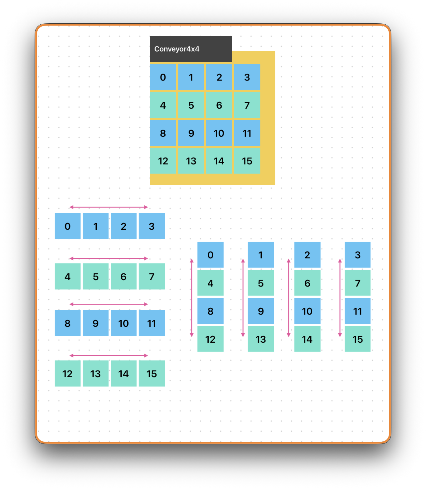
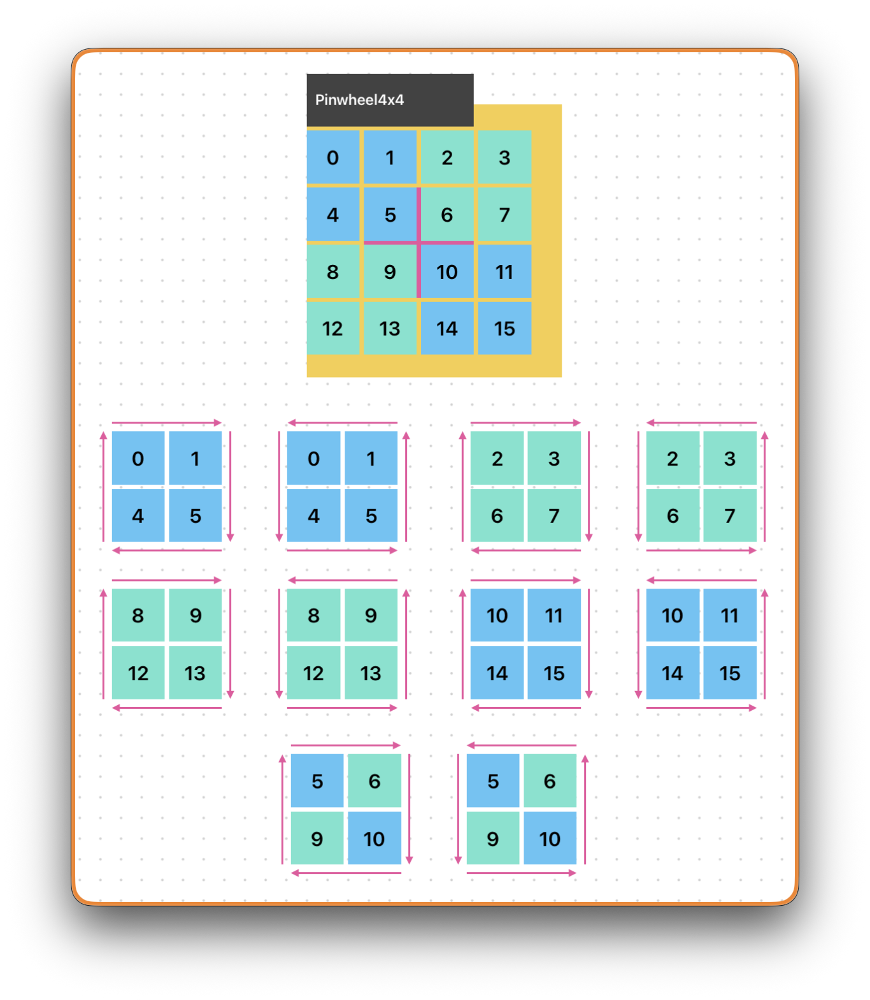
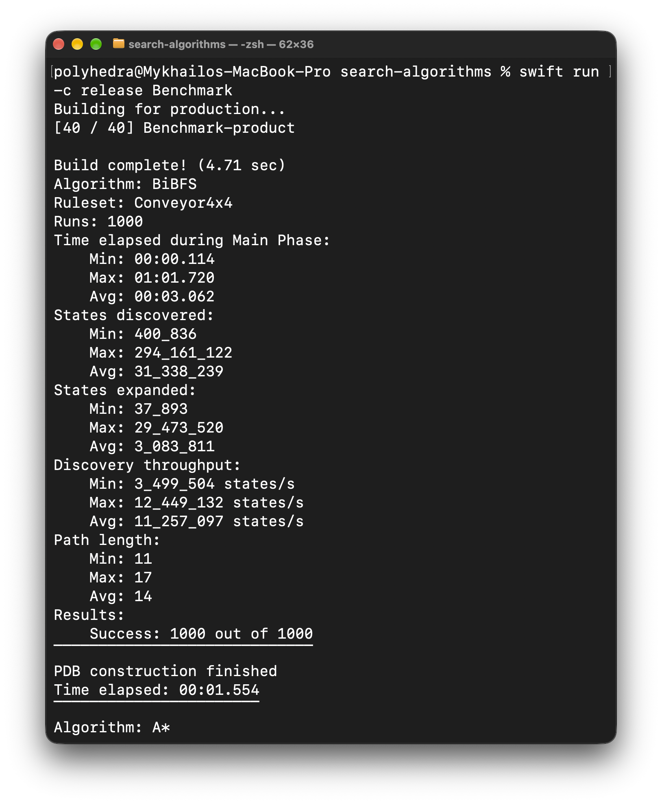
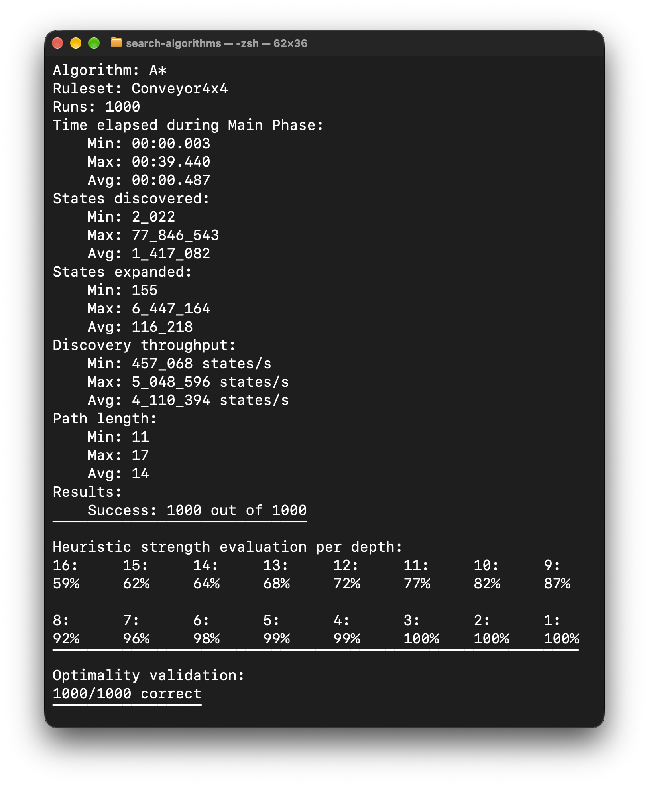

# search-algorithms

**This is not a puzzle project.** It is an exploration of high-performance search algorithms in Swift. Puzzles provide a convenient family of test problems with different branching factors, state-space sizes, and solution depths. As Patrick H. Winston stated in his 6.034 lectures, a search is not about maps; it’s about choice. This means it is not about puzzle-solving either. The algorithms operate on `UInt64` states and caller-supplied transition closures, rather than on puzzle types.

## Why this project exists

Not too long ago, I was introduced to the vast world of puzzle-based adventure games on the App Store. Though most of the games were pretty simple, one introduced a puzzle I couldn't solve, and I was too stubborn to just move on and forget about it. Instead of blindly clicking through the confusing UI, I quickly decided to grab a pen and paper to draw simplified transitions, which would give me a better sense of what my goals were supposed to be. That, however, didn’t prove successful, as there were just way too many things to draw, so I was forced to resort to the last option: a Terminal app.

The puzzle in question was a distant relative of what I now call a `Turntable2x5`. After designing the minimum requirements needed to apply moves and search for an optimal solution, I did manage to solve it, at the cost of introducing a much more demanding problem. My inner Opus Magnum player simply couldn’t sleep peacefully until I knew how far I could push it. Could I make it cheaper? More compact? How could I properly model something so intricate while avoiding both cognitive bloat and performance degradation?

It soon became obvious that my initial playground project simply won't cut it for a very simple reason: it was designed to deliver immediate results rather than scale across multiple problems and algorithms. This is where `search-algorithms` comes into play: a dedicated package with clear domain boundaries and proper models that allows for brutal refactoring and quick changes to anything connected to the search side itself—no human interactions, no prompts, nothing. Since the initial problem was so simple, I needed to design more puzzles to benchmark against. You can see the most notable ones below.

| Conveyor4x4 | Pinwheel4x4 |
| --- | --- |
|  |  |

## Quick structural overview

The ability to turn writing code into an iterative process, continuously refactoring things that don’t hold up, comes mainly from its low cost. If a change needs to affect multiple files and domain concepts, nobody is going to make it. Achieving this experience requires proper domain modeling, as changes to self-contained models with a clear separation of concerns are minimal by definition. The main targets I settled on are as follows:
- `PuzzleDomain` is the most abstract one, defining `Puzzle` as an immutable struct and a `Ruleset` protocol, which the former is generic over. The important thing to note is immutability, as `Puzzle` does not concern itself with ongoing solutions or puzzle sessions. Instead, it defines the absolute bare minimum required for the model to be called a `Puzzle`  to begin with: creating a shuffle, defining a victory condition, and providing an API for transitions for said victory to be achieved.
- `PuzzleRulesets`, on the other hand, is where concrete implementations live. For this project, I have limited myself to boards with at most 16 cells, which conveniently fit into a single `UInt64`, given that each tile fits in a nibble (4 bits). Notice that this is not a defining trait of a `Puzzle` itself, imagine yourself adding a Lights Out puzzle or a 5×5 Scramble. Are those puzzles? Absolutely! Can you represent those using a `UInt64` nibble-based model? No, you can't. This led to the introduction of `Nibble16Ruleset`, which revolves exclusively around movesets that rely on this specific representation. Should one need to introduce another representation in the future, they can add a different `Ruleset` conformant.
- `Algorithms` is the core of the entire project. It contains an exhaustive breadth-first search (BFS), capable of calculating distances to the target by traversing predecessors; a bidirectional variant (BiBFS), designed to find an optimal solution through uninformed search; and an A\* algorithm, designed for more difficult problems but requiring a heuristic estimate.
- `PuzzleSearch` is a bridge that combines the worlds of search and puzzles, allowing them to remain unaware of each other. Aside from defining a convenient `forEachSuccessor` closure to be used by search algorithms, it houses a `PDBHeuristic` implementation, which I shall cover extensively in later sections.
- `Presentation` contains formatting and display helpers. 

## BiBFS: making the main phase cheap

First things first: why skip BFS when searching for an optimal solution? Well, we do know both endpoints in advance, and the movesets in the benchmark are inverse-closed, meaning we can trivially generate both successors and predecessors. This is not a matter of dividing the search space in half, but rather of reducing it to roughly its square root, so we would never choose to skip an optimization like that. Despite the textbook implementation of BiBFS being relatively simple, there are still quite a few areas to improve, most importantly the bookkeeping.

You see, in a level-by-level expansion variant, a solution is found when the origin and target sides intersect. The fact that an intersection is found merely means that a solution exists, but the concrete path leading to said solution remains unknown. The easiest approach would be for both sides to keep dictionaries `[State: State]`, remembering the parent of each new generated state. This does work and is perfectly fine for simpler puzzles, but once you get to harder instances, you start noticing that as memory consumption grows, throughput ends up declining substantially, leading to a much slower search. Not only does one end up doubling the amount of memory required to track each state, but one is also forced to perform three dictionary operations per successor, which is by far the dominant cost of the search.

This is the part where I felt like this project is actually pretty fun, as it allowed for some algorithmic creativity. I ended up exploiting the fact that BiBFS cuts the search space so drastically that firing a secondary search from a shallower depth ends up being pretty much free. Instead of keeping track of parents during the process of finding the intersection, I introduced a single large dictionary that only keeps track of which side the state was discovered from. Combined with some clever usage of `updateValue` from Swift's `Dictionary` type, one ends up limiting the amount of dictionary operations per generated state to only one. An intersection is a point that is guaranteed to be on an optimal path, and both successor and predecessor closures are already provided to us in the public entry point, with nothing preventing us from searching Origin ↔ Intersection ↔ Target. This means we can introduce two secondary searches that actually do `[State: State]` bookkeeping, but on such a small scale that they end up being indistinguishable from benchmarking noise.

With these optimizations in place, BiBFS ended up being extremely fast, as shown in the benchmarking results in the closing sections. That said, no amount of micro-optimization can save it from the exponential curve on the hardest puzzles I had in store. I find `Conveyor4x4` to be a great example to illustrate the point: it has a state space of 16!, a branching factor of 16, and the hardest generated instances were of depth 16. Depth-14 shuffles are solved in a fraction of a second, while depth-15 shuffles might take a couple of seconds at worst, discovering roughly 40M unique states on average, with a throughput of ~11M states per second on an M1 Max. Depth 16? Well, it explodes into a 300M-state search, drastically lowering the throughput and taking up to a minute to finish. At this point, only algorithmic improvements can save the day, which brings us to A\*.

## A\*: an informed search

What does it mean for a search to be informed? It means having a heuristic estimate, denoted by `h`, that approximates the distance to the target. I have to mention the two types of heuristics, as they affect search optimality. An admissible heuristic never overestimates the remaining distance, providing a lower bound on the actual solution cost. A consistent heuristic additionally guarantees that its estimate cannot decrease by more than the cost of the move just taken. In other words, the heuristic changes smoothly along a path rather than making unrealistic jumps toward the target. Consistency implies admissibility and allows A\* to preserve optimality without reopening previously expanded states.

There is a second parameter required for A\*, which is the best known distance from the origin, denoted by `g`. Combine the two together and you get `f = g + h`. A state with the lowest `f` gets expanded first, meaning we don’t necessarily need to sort the entire agenda every time, but we do need to be able to pop the minimum value at a moment’s notice. Let us assume that we have already been provided with a closure to calculate `h`, as this is a much more complex requirement, to which I shall dedicate the entire next section. What data structure do we use to arrange elements by `f`? The natural answer would be a `Heap` from `swift-collections`, and it would indeed be a good general solution. How about we exploit the fact that both the `g` and `h` values we’re working with are very small natural numbers, meaning we don’t actually need one giant `Heap` filled with duplicates? Instead, we could introduce a 256-element array, where each index corresponds to a UInt8-bounded `f`.

The `Heap` is not out of the game, however, as there is one more optimization we can introduce. The definition of A\* is only concerned with `f`, true, but that doesn't mean certain tie-breaking scenarios can't help us reduce the number of expansions even further. You see, `f` in itself actually loses the information about the exact `g` and `h` values used for addition. By storing `g` separately we get an ability to prioritize deeper elements that end up having the same `f`. This does not harm optimality, and is not universally helpful. When working with our puzzles, however, this reduced the number of expansions by roughly a factor of 10, further demonstrating that one should try to use as much of the given information as possible. I named the resulting data structure `BucketQueue`.

Since the number of expansions is modest compared to BiBFS, we use `[State: State]` bookkeeping from the very beginning; there’s no need to introduce anything substantially more complex just for the sake of it. With A\* implementation itself out of the picture, it's time to address the elephant in the room, which is `h`. Depending on the problem, there are many ways to introduce a heuristic estimate, some of which are substantially easier than others. For a map search, for example, you could get away with calculating the Euclidean distance and get good enough results. In a Scramble, you could try introducing what is known as Manhattan distance, and perhaps it would work well enough. Both examples are just a couple of lines of code, and they just so happen to be completely useless in our domain. Thankfully, we do have a working solution, albeit one that’s orders of magnitude harder to implement: pattern databases (PDBs).

## PDB heuristic: design

I knew from the get-go that this was going to end up being the largest section, which I would want to cover extensively. You see, while A\* is supposed to end up having fewer expansions than BiBFS given a strong enough heuristic, the additional computation of `h` is something the latter never has to concern itself with. In fact, A\* needs a much larger pipeline to get going, meaning we have many more opportunities to write a poor implementation somewhere along the line and drag the entire algorithm down. This is, of course, unacceptable, as we have to outperform said BiBFS by a wide margin to justify A\*’s existence in the first place.

So, what’s a PDB heuristic? The idea is pretty simple: you abstract most of the board away, keeping only `k` tiles out of `n`. You then calculate the distance from each possible placement of those `k` tiles to their canonical arrangement and call it a day. Until you realize that you have to come up with a data structure to maintain said arrangement-to-distance relation—and, worse yet, you have multiple such PDBs. Let's start with a naive implementation to illustrate the point. Let’s go ahead and introduce a dictionary `[State: Distance]`. Whenever we’re asked for a heuristic estimate, we mask away untracked tiles, calculate the hash, and potentially go through multiple probes. Then we repeat the process `N − 1` times, where `N` is the number of PDBs. For reference, my resulting implementation ended up with six PDBs, meaning that in this step alone, we’ve already introduced six dictionary operations and six 16-iteration loops, while BiBFS needed only one dictionary operation and no loops for the entire cycle. Notice that I didn’t even need to mention half the branches being mispredicted, because the implementation is already in shambles. We would need something along the lines of a "100% accurate heuristic" to make this work, and this is not even the entire process. Ok, let's slow down and distinguish which things we actually need to model this beast.

#### Target

When faced with the unknown, it’s usually beneficial to start with something dead simple. I hail from Team TDD (no, not Team Test-Driven Development—Team Type-Driven Design), so we’re going to create a separate type to parse some arbitrary `[Int]`. What are the invariants needed to be enforced by said type in order for some array to be classified as a `Target`? Well, for starters, it does need to have distinct tiles, as asking a PDB to track the position of “tile 2” is pretty nonsensical when there’s more than one of them. It must not be empty, as there would be no tiles to track, and the upper bound on size is clearly 16. Each element must fit in a nibble, and—believe it or not—that’s not all. To refine the requirements, we need to get further along in the modeling process.

#### Pattern

Ok, so let's model the `k` tiles themselves. Naturally, we need these to be distinct, too, but at this point, we might as well just start accepting a `Set` to enforce that. We need a `Target` to verify against; if a tile is not present therein, how would we track it? Back to the dreaded size constraint… Clearly, a pattern cannot be empty, that much is obvious. But why would we accept a 16-tile pattern, if such a PDB is pretty much impossible to build in the first place? What even qualifies as a reasonable PDB at this point? How do we even store these tiles, as a `Set`? This entire ordeal raised more questions than it answered. Let’s try our luck elsewhere.

#### Ranker

That's a new one, what's a `Ranker`? This is the answer to the six dictionary operations stated at the very beginning of this section. Thankfully, this problem has already been solved and is known as a “lexicographic ranking of a partial permutation.” It's pretty much impossible to understand properly from a single paragraph of text, but I shall try my best. Each tracked tile contributes a digit describing its position among the cells not already occupied by earlier tracked tiles. These digits use a mixed-radix representation: the first has `n` possible values, the next `n − 1`, and so on. Combining them produces a unique, dense index for every placement of the pattern's tiles.

This gives us a tremendous amount of information. So much so, that we are more than ready to answer most of the previous questions. As is tradition at this point, I shall start with the naive approach. We may skip `Array` and `Set` representations at this point, as there’s simply no way they’re going to cut it in the context of a low-level `Ranker`. We could try defining the tracked tiles as a `UInt16`, marking them as 1s against 0s, but we would lose the order information that way and have to waste CPU cycles to restore it. A `UInt64` with explicit ordering solves this problem, but imagine the number of mispredicted branches when filtering out the tiles we don’t care about.

It’s at this point that we should slow down and ask ourselves, “What are we actually ranking?” One might initially think we’re ranking a state, but in reality, we’re ranking positions. Instead of suffering through `N` `n`-iteration loops to see which cells contain tracked tiles, we can invert the state from position → tile to tile → position once. This also means the entire pattern can be stored in the lower nibbles of either `UInt32` or `UInt64`, as we are no longer bound to irrelevant tiles. Each PDB now performs only `k` iterations, finally begging the question: what is the bound on `k`? The answer is a compile-time constant: 6 for now. You see, eliminating a runtime loop bound is yet another optimization we can introduce, and there is simply no need for us to refuse it. The same goes for `n`: it's 16. We can't afford flexibility that will never be used at the cost of the runtime performance of what's actually needed right now. Anything below that line is just too shallow to need a PDB to begin with.

#### Configuration

Despite showing exceptional results on `Conveyor4x4` benchmark, the 6-tile setup ended up choking on the worst-case scenarios of the hardest puzzle I had in store, namely `Pinwheel4x4`. This meant we had to introduce 7-tile tables, which are 10 times more expensive to compute and store. The higher cost introduces compromises, as should just a couple of such tables suffice, we could just as well leave the rest as 6-tile, cutting down on computations. After trying out a couple of prototypes in Playgrounds, I settled on introducing a `Configuration` enum to distinguish between the two, as other variants overcomplicated the code beyond what I deemed acceptable. The result is a single `PDBHeuristic` that combines both PDB variants, with `Configuration` specifying the table size and ranking path.

## Measurements and trade-offs

Below are the metrics from 1,000 `Conveyor4x4` runs of BiBFS and A\*, benchmarked against the same random endpoints. You can see that, despite taking an average of half a second to solve the puzzle, depth 16 does end up taking about 39 seconds. Keep in mind that `Conveyor4x4` is limited to 6-tile PDBs. I didn’t consider a rare tens-of-seconds case extreme enough to justify introducing 7-tile PDBs for this puzzle. BiBFS is therefore used only for demonstration purposes, as A\* is highly preferred for this puzzle.

| BiBFS | A\* |
| --- | --- |
|  |  |

## Future work and contact

Although this project is focused on low-level performance, I do plan to introduce a second one to add a human-facing UI in the near future. It would be a shame to let all these models go to waste. I see it as a synchronous Terminal app using a lightweight analogue of TCA as its architecture of choice. Now that I've mentioned it, I normally develop for Apple platforms using SwiftUI and TCA, this one is just a personal engineering project, an exploration of sorts.

My name is Mykhailo. You can contact me at polyhedra99@icloud.com for questions or proposals.
